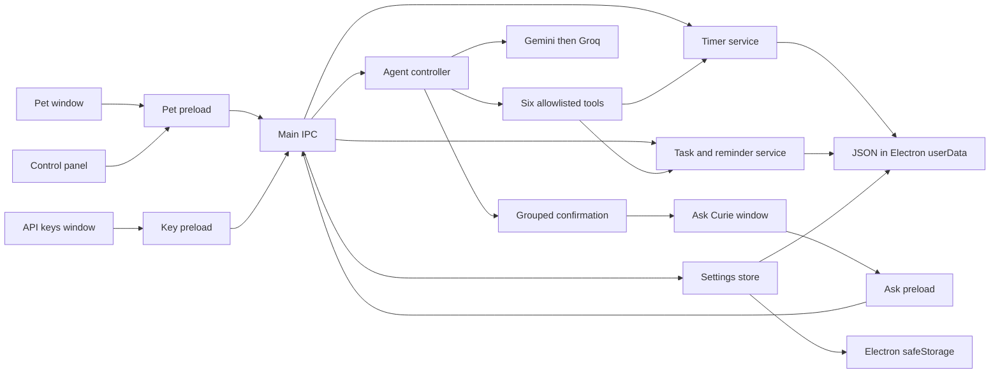

# Curie architecture

Curie keeps the desktop pet and control windows small. The main process owns operating-system features and local data; renderer pages receive only narrow preload APIs.

## Data flow

- Pet, panel, Ask Curie, and API keys each use isolated BrowserWindows with Node integration disabled. Preload bridges expose specific methods and never expose `ipcRenderer` itself.
- Timer, tasks, reminder scheduling, nudge rules, and the agent tool loop have pure modules that Node's test runner can exercise without launching Electron.
- The timer uses absolute `endAt` timestamps and writes state on state changes. Timer menu, tray, panel, pet countdown, shortcut, and notifications share one timer service.
- The task and reminder store lives in Electron `userData`. An explicit reminder fires at its selected time, including quiet hours; automatic deadline nudges remain local, obey quiet hours, and cap at three per local day by default.
- Ask Curie is opened from the right-click menu or `Ctrl+Option+A` through the same `openAskWindow` function. It sends the current message and at most 50 open tasks with minimal fields. The prompt receives current date/time and timezone on each provider call.
- Gemini is tried before Groq. There are exactly six tools: `add_task`, `list_tasks`, `complete_task`, `delete_task`, `set_reminder`, and `start_focus`. All task writes are proposed in human-readable form and wait asynchronously for one Confirm all / Cancel all response. Cancellation, window close, Escape, or a five-minute timeout sends `user cancelled` back to the loop. `list_tasks` and `start_focus` execute immediately.
- Provider calls use a 20-second per-call timeout and a 512-token output cap. Each provider HTTP attempt, including fallback and key tests, counts against a persisted settings counter: 400 calls per Asia/Kolkata day by default, configurable from 50 to 1500, plus 20 calls per rolling minute. Confirmation time is outside provider timeout and loop iteration limits.
- API keys are encrypted by Electron `safeStorage`; storage is refused if encryption is unavailable. Keys travel only in Authorization headers. Logs and the debug overlay show only key-present booleans. Provider error bodies are not read or displayed. Request logs contain provider, iteration count, tool names, latency, and error category; they omit user and model text.
- The agent has no file, shell, browser, screenshot, email, Gmail, or other-app access. Local timers, tasks, reminders, and nudges work without network access or API keys. Local call caps do not control provider billing; configure a free-tier key and do not enable paid billing.
