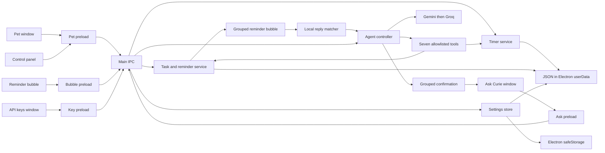

# Curie architecture

Curie keeps the desktop pet and control windows small. The main process owns operating-system features and local data; renderer pages receive only narrow preload APIs.

## Data flow

- Pet, panel, Ask Curie, and API keys each use isolated BrowserWindows with Node integration disabled. Preload bridges expose specific methods and never expose `ipcRenderer` itself.
- Timer, tasks, reminder scheduling, nudge rules, and the agent tool loop have pure modules that Node's test runner can exercise without launching Electron.
- The timer uses absolute `endAt` timestamps and writes state on state changes. Timer menu, tray, panel, pet countdown, shortcut, and notifications share one timer service.
- The task and reminder store lives in Electron `userData`. Explicit reminders are scheduled against wall-clock time, including quiet hours. Due and missed reminders appear in one frosted bubble with Done, Snooze, and Skip controls; macOS notification banners are not part of this path. Automatic deadline nudges remain local, obey quiet hours, and cap at three per local day by default.
- The reminder bubble follows the pet and groups due reminders. Simple replies such as “done”, “snooze 20 minutes”, and “skip” are handled locally. Other replies use the existing agent loop with a small reminder context. The bubble keeps up to three exchanges in memory; closing it clears that history. Pushback is decided locally by the pure `evaluatePushback` in `src/core/pushback.js`: snoozes and skips both count as deferrals, the third deferral always pushes back, the first pushes back when the task is overdue or due within two hours, and the second when it is overdue or due within 24 hours.
- A task with a due date and no explicit reminder gets a local plan from `src/core/reminder-plan.js`. Effort comes from the agent's `estimate_minutes` or from scope words in the title. Work due within 12 hours or estimated at 2 hours or less gets one reminder 2–4 hours before the deadline; longer work gets a rhythm of one reminder a day, or two a day when the estimate is 8 hours or more, spread across the days left. Plans stay out of quiet hours and cap at 40 reminders. Skipping one planned reminder advances to the next; Done ends the plan.
- Deferral pushback is now feasibility-based, not just a deferral counter. `src/core/deferral.js` compares the estimate with the time actually left (`dueInMs - snoozeMinutes`). A negative slack produces strong pushback with the numbers and options; a thin margin warns; plenty of slack stays quiet. Repeated deferrals still escalate. The same assessment gates the bubble Snooze/Skip buttons, typed snooze/skip, and the panel reminder buttons, so no path can bypass it. `assessDeferralGroup` keeps the worst warning when the bubble holds several tasks.
- Deadline nudges are delivered in-app. `notifyNudge` no longer creates a macOS notification; it files a notice that appears in the panel and raises a persistent badge on the pet. Pending reminders also keep that badge, and clicking it reopens a bubble the user had hidden. This makes the in-app channel durable instead of a transient window.
- Greetings, thanks, capability questions, and “what is next / how are you” are answered by `src/core/local-intent.js` before any provider call. Messages that contain real work, dates, or ambiguity return `null` and go to the model.
- A day request becomes a task tree through `plan_day`. The model supplies titled blocks with durations; `src/core/day-plan.js` owns the clock arithmetic, inserts breaks, rejects overlaps with existing blocks, rejects overruns into quiet hours or past midnight, and saves one parent plus child tasks carrying `parentId`, `blockStart`, `blockEnd`, and a reminder at each block's start. The panel renders children under the parent with their time range. Completing or deleting the parent applies to its child blocks too, so a finished plan cannot leave orphan blocks reminding on their own.
- A reminder found overdue at app startup or power resume is labeled Missed. During normal awake scheduling it says Due now unless it is displayed more than five minutes after its due time. Snooze and Skip counts are persisted per reminder; Skip leaves the linked task open.
- Ask Curie is opened from the right-click menu or `Ctrl+Option+A` through the same `openAskWindow` function. It sends the current message and at most 50 open tasks with minimal fields. The prompt receives current date/time and timezone on each provider call.
- Gemini is tried before Groq. Both providers use the shared Bearer-auth header builder for chat, key tests, and model discovery. There are exactly seven tools: `add_task`, `list_tasks`, `complete_task`, `delete_task`, `set_reminder`, `start_focus`, and `plan_day`. All task writes are proposed in human-readable form and wait asynchronously for one Confirm all / Cancel all response. Confirmation cards and per-tool resolutions are logged without task text. Cancellation, window close, Escape, or a five-minute timeout sends `user cancelled` back to the loop. `list_tasks` and `start_focus` execute immediately.
- Provider calls use a 20-second per-call timeout. Gemini and Groq output caps are configurable in Settings (2048 and 1024 defaults); key tests use a separate 1024 cap. Each provider HTTP attempt, including fallback and key tests, counts against a persisted settings counter: 400 calls per Asia/Kolkata day by default, configurable from 50 to 1500, plus 20 calls per rolling minute. Confirmation time is outside provider timeout and loop iteration limits.
- API keys are encrypted by Electron `safeStorage`; storage is refused if encryption is unavailable. Keys travel only in provider-specific authentication headers. Logs and the debug overlay show only key-present booleans. Sanitized provider 400 messages can be shown; request logs omit user and model text.
- The agent has no file, shell, browser, screenshot, email, Gmail, or other-app access. Local timers, tasks, reminders, and nudges work without network access or API keys. Local call caps do not control provider billing; configure a free-tier key and do not enable paid billing.
