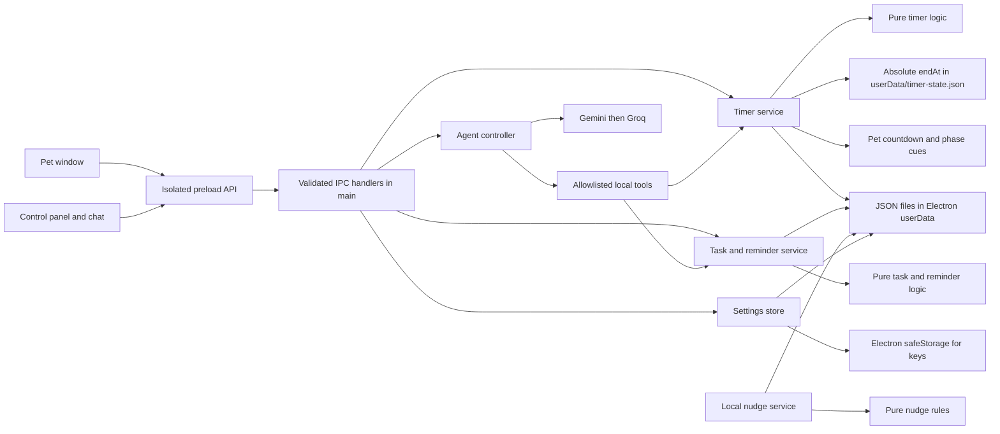

# Curie architecture

Curie keeps the desktop pet and control panel small. The main process owns operating-system features and local data; renderer pages only get the narrow methods listed in the preload bridge.

## Data flow

- The pet and panel are separate BrowserWindows. Both run with context isolation and without Node integration.
- `preload.js` exposes only specific timer, task, reminder, settings, and chat functions. It does not expose `ipcRenderer` itself.
- Main-process handlers call services. Timer, tasks, reminder scheduling, and nudge rules live in pure modules so Node's test runner can exercise them without Electron.
- The timer core owns FOCUS, SHORT_BREAK, LONG_BREAK, and IDLE transitions. It stores absolute `endAt` timestamps (plus pause metadata), computes remaining time from the clock, and only asks the service to write state when a transition or action changes it. The tray, menu, panel, pet countdown, shortcut, and native notifications all call the same timer service.
- Timer durations and the long-break cadence default in `assets/timer.json`. The `timer-state.json` file remains under Electron `userData`; a restart or sleep catch-up advances to the current phase and emits at most one catch-up notification per refresh.
- The main process applies the optional “Calm during focus” preference through the existing calm owner. A revision lease restores the previous calm setting at focus end only when the user did not change it manually. The small timer label uses a separate click-through overlay that follows the pet, so the pet window's bounds and pointer handling stay unchanged.
- The task, timer, nudge-suppression, pet-position, and non-secret settings records are local JSON under Electron's `userData` path. Provider keys are encrypted with the OS-backed Electron `safeStorage` API before they are written.
- A chat request sends the user's current message and at most 20 active tasks with only id, title, subject, due time, estimate, and status. Chat is the only path that contacts an external model provider. The model can call only Curie's declared local tools; deleting a task requires a confirmation dialog.
- Local deadline nudges do not contact a model. Optional macOS Shortcuts run locally through `execFile` and are disabled until the user enables them.

## Important boundaries

The agent has no file, shell, browser, screenshot, or other-app access. Timer, reminders, and nudges continue to work without network access or API keys. Chat call limits apply to requests from this running app instance; they are not provider billing controls, so use a free-tier key and do not enable paid billing.
